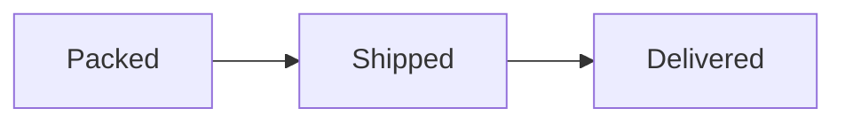

Chatto stores every message as Markdown. You can write with the visual editor or edit the Markdown source directly; recipients see the same formatted message either way.

## Choose an editor

Select the App Preferences gear in the Application Header. Settings opens the **Overview** page for your active server. In **App preferences**, open **Composer**. In **Message editor**, select an option:

- **Markdown** to edit source syntax directly, with Markdown and fenced-code highlighting. This is the default.
- **Visual** to format text without seeing Markdown markers.

The setting applies to every Chatto server you use in the current browser. It does not sync to other browsers or devices.

Select **Formatting options** in the message input to show or hide the toolbar. Chatto hides the toolbar by default. It remembers your selection in this browser and uses it for all message inputs.

Both editors provide the same formatting toolbar, mentions, emoji completion, attachments, reply quotes, timestamps, and message editing. The Markdown editor always shows source; it does not include a separate preview.

The toolbar's indent and outdent actions follow the selected editor. In the visual editor they nest and unnest list items. In the Markdown editor they indent or outdent the current source line, or every line in a selection. Use Tab or Shift+Tab to move keyboard focus out of the Markdown editor. Tab still accepts an active mention or emoji suggestion first, and repeated Tab presses cycle through matching mentions.

## Link to a room

Type `#` at the start of a message or after a space to open the room picker.
Continue typing to find a channel room on the current server. Use the arrow keys
to select a room, then press Enter or Tab. You can also click a room. Press Escape
to close the picker.

Search is fuzzy: type `#designteam` to find **Design Team**. Omit spaces from the
search because Space closes the picker. Universal rooms show a globe;
other channel rooms show `#`.

The picker inserts a room link. Sent messages show the room's current name when
the reader can see that room. Direct messages and archived rooms are not listed.
Both editors support the picker in messages, replies, and edits.

Enter and Tab accept the selected room without
adding whitespace or sending the message. Mention (`@`) and emoji (`:`) suggestions
use the same keys. Clicking a suggestion adds a space.

Space types a normal space and closes the suggestions. You can type `#` followed
by a space to start a Markdown heading.

## Profile text

In **Settings → Profile**, the **About** field uses your selected Markdown or visual editor and the same formatting toolbar. Use **Save** to save your changes. The limit is 1,000 characters, including Markdown syntax.

About text uses the same Markdown formatting as messages, including paragraphs, headings, lists, quotes, code blocks, tables, links, and timestamps.

## Write and send

In **App preferences**, open **Composer**. In **Send messages with**, select an option:

- **Return** to send with Return. This is the default. Use `Ctrl+Return` on Windows and Linux or `Cmd+Return` on macOS for the editor's normal Return action.
- **Cmd/Ctrl+Return** to send with `Ctrl+Return` on Windows and Linux or `Cmd+Return` on macOS. Return performs the editor's normal action.

The normal Return action starts a new paragraph or line, continues a list, leaves an empty list item, or adds a line inside a code block as appropriate. In the visual editor, `Shift+Return` always inserts a hard line break.

On touch-primary devices, Return always edits the message. Use the visible **Send** button to send.

## View attachments

Select an image or file in a message to open the attachment viewer. For an image, use **+**, **−**, or **Fit** to change its size. You can also zoom over the image with a wheel or trackpad, double-click it, or pinch on a touch screen. Drag the image to move it when it is enlarged. Select **Details** to show its description, file type, and size. **Download** saves the original file.

Use the arrow buttons or the left and right arrow keys to move between images in the same message. The viewer fits each new image to the screen. Press Escape to close the viewer.

## Emoji shortcodes

Select **Insert emoji** (the smiley button) beside the attachment and timestamp
controls to open the emoji picker. Select an emoji to insert it at the cursor or
replace selected text. This works in both editors, including thread replies and
message edits.

Type `:wave:`, `:heart:`, or `:+1:` to show 👋, ❤️, or 👍 after sending.
Names are case-sensitive. Unknown names, such as `:custom-party:`, stay as text.
You can also type or select Unicode emoji as before.

Add a skin tone with `:thumbsup::skin-tone-4:` to show 👍🏽. Tone numbers range
from 2 (light) to 6 (dark). Compound emoji also work, for example
`:woman_health_worker::skin-tone-5:` shows 👩🏾‍⚕️. Unsupported combinations,
such as `:heart::skin-tone-4:`, stay as text.

In the emoji picker, select an emoji to open its skin-tone choices. Choose yellow
or one of five skin tones. Back or Escape returns to the previous search. Recently used
emoji select their exact tone immediately.
Both the emoji picker and shortcode suggestions use fuzzy search across names,
aliases, and tags. For example, type `:headshakingvertically` to find
`:head_shaking_vertically:`. Exact names rank first. You must accept a suggestion
to insert the emoji; an incomplete shortcode stays as text if you send it as typed.

In autocomplete, accept an emoji with Enter, Tab, or a click to open its skin-tone
popup. Your saved tone is highlighted. Use Up and Down to choose a tone, then
Enter or Tab to insert it without a trailing space.
Escape returns to the emoji suggestions. You can also
click a tone. Emoji without skin tones insert immediately.
Chatto remembers the choice in this browser and uses it for supported picker
and autocomplete choices, including reactions. Recently used emoji keep their
original tones. A shortcode that you type explicitly keeps its specified tone.

Separate shortcodes from letters, numbers, combining marks, and literal underscores.
For example, `omg:poop:foo` stays as text, while `omg :poop: foo` shows an emoji.
Punctuation and adjacent tags work: `(:wave:)!` shows (👋)!, and `:wave::heart:`
shows 👋❤️. Emoji suggestions use the same opening boundary and appear after
you type at least two characters of a name.

Shortcodes stay visible as text while you edit. Chatto keeps them in the message
source, so reopening a message or selecting **Copy message text** retains them.
Put a shortcode in inline code, such as `` `:wave:` ``, to show it literally.
Shortcodes in code blocks and URLs stay unchanged.

## Supported Markdown

Chatto formats:

- paragraphs and ATX headings such as `## Heading`;
- bold, italic, and underlined text;
- links and automatically detected URLs;
- inline code, fenced code blocks, and indented code blocks;
- blockquotes;
- ordered and unordered lists;
- named footnotes;
- GFM pipe tables, including column alignment and escaped pipes; and
- Chatto timestamp tokens inserted from the composer toolbar.

Use `__text__` for underline, `**text**` for bold, and `*text*` for italics.
Double underscores mean underline in Chatto, including in existing messages.
They do not add formatting inside inline code or code blocks.
In either editor, select **Underline** in the formatting toolbar or press
**Ctrl+U** (**⌘U** on macOS) to toggle underline on the selected text.

```md
## Release status

- **Ready:** web client
- **Waiting:** desktop package

> Deploy after the final check.

| Component | State   |
| --------- | ------- |
| Web       | Ready   |
| Desktop   | Waiting |
```

Chatto displays source HTML, horizontal rules, reference-style links, and setext headings as literal text. Markdown image syntax does not embed remote images; upload an attachment instead. Label a fenced code block with a supported language, such as `js`, `go`, or `ruby`, to highlight its programming syntax while composing and after sending.

In the visual editor, paste into a code block without a language, or leave the block after typing, to detect its language. The editor saves its guess so the posted message uses the same syntax colors. You can change the language in the block's selector. Choose **TEXT** to keep the block as plain text. Existing blocks do not change merely because you open a message for editing.

Each code block has a header with its language and **Copy to clipboard**. Copy retains the original source without the Markdown fence.

SVG, Mermaid, and ANSI blocks also have **Source** and **Render** tabs. They start on **Source**. Add `rendered` after the language, such as `mermaid rendered`, to start on **Render**. You can switch tabs without changing the message.

In the visual editor, select an SVG, Mermaid, or ANSI code block and enable **Render by default** beside its language selector. This sets the same `rendered` hint. The editor continues to show source.

Plain URLs to users, rooms, and servers that your client knows appear as pills with
their current name and avatar or icon. This includes angle-bracket URLs.
Markdown links such as `[the development channel](URL)` keep their labels and
normal link display. The visual composer previews plain URLs as pills; select
a preview to edit its URL. Select a pill in a message to open its destination. Right-click
or long-press it to open the entity's menu. These links do not notify users
as mentions do.

Other automatic web links appear as compact chips with a hostname and, when it
fits, a short, complete path. Long paths and opaque identifiers stay out of the
label. Long hostnames shorten in the middle, keeping their ending and port visible.
Query strings and fragments stay out of the label. This also applies to unknown
or unavailable Chatto destinations and to thread links. Hover over a
chip to preview the destination, or use **Copy Link** in the message menu for the full URL. The visual
composer uses the same compact display; select a chip to edit its full URL.
Posted web-link chips load page details when they enter view. A spinner appears
while the details load, then the page title appears beside the hostname when
available. If no title is available, the chip keeps its hostname and short path.

Message links to known servers show a message icon and the room or server name.
If the message is already in the client's loaded history, the pill also shows
the author's name and avatar. The attached preview uses a compact inset body;
scroll inside it to read a long message, or select it to open the original.

Hover over a pill or a Markdown link, or focus it with the keyboard, to inspect
its destination. Markdown links keep their authored text and formatting.
Known Chatto entities show locally available details. Web-link cards reuse details
loaded for their chips. Markdown links with authored labels load details when
the hover card opens. The message's server receives the URL and fetches
the details and images; the website sees the server's IP address. Existing
composer previews are unchanged. Select any part of the hover card to open its
destination. You can also Tab into the card and press Enter. Press Escape to
dismiss it and return keyboard focus to the original link.

On a touch screen, press and hold a link to show its preview in a bottom sheet.
Select **Open link** or **Copy link** below the preview. User, room, and server
pills also keep their usual actions. Tap outside the sheet or use its close
control to dismiss it. A normal tap still opens the link immediately. Moving
your finger scrolls the conversation without opening a preview.

Right-click an ordinary link in a message to open the message menu. Select **Copy Link**
to copy that URL, or **Copy Message Link** to copy a link to the message.
Hold Shift while you right-click a link or pill to open your browser's native menu.
This gives access to browser actions such as copying without tracking parameters,
when supported. The Chatto menu shows a reminder of this shortcut.
Ctrl-click, Command-click, Shift-click, and middle-click keep your browser's usual
tab and window behavior.

To share a server, right-click its sidebar icon or a server pill and select
**Copy server link**. This copies the full server URL.

To share a room, right-click its sidebar row and select **Copy room link** from the
room menu. Copied room and message links use the address of the server that
owns the conversation, even when you use a frontend on another server. Thread
message links also identify the thread. A link does not grant access to a room.
When you select one of these links in a message, known servers open in your
current client. Unknown servers open externally.

Right-click an image attachment in a message and select **Copy Image** to paste the image into another app. Use **Download** in the attachment viewer to save the original file.

### ANSI art

Put ANSI text inside a fenced code block labelled `ansi`. After you send the
message, select **Render** to see its colors and final screen layout. Cursor movement and
erase commands can draw over earlier text. The composer shows the source.

Bots can build a message body like this JavaScript example:

```js
const body = '```ansi rendered\n\x1b[91mHello in red!\x1b[0m\n```';
```

The JavaScript string contains an actual Escape character (`U+001B`). Typing the
literal text `\x1b` into the message editor does not create that character. Use
Unicode text for block and box-drawing characters; raw CP437 files are not imported.

Art uses 80 columns and up to 100 screen rows, with no scrollback. Content that
scrolls above the screen is discarded. Wide art scrolls horizontally. All screen rows remain visible.
The background stays black in both themes. Chatto supports 16-color, 256-color,
and true-color text. It does not play animations or blink text, and terminal
links and clipboard commands have no effect.

The first four ANSI blocks in a message render as art. Additional blocks show
their source. The normal message size limit still applies. **Copy to clipboard**
copies the original code, including its escape characters.

### Mermaid diagrams

Use a `mermaid rendered` code fence to show a diagram first:

````text

````

Chatto renders diagrams locally with [Pele](https://pele.run/). It does not send
the source to a rendering service. Diagrams follow your theme. Large SVG and
Mermaid previews fit inside the message. Select **Open larger** to pan and zoom
in the image viewer. Its footer has zoom controls and **Fit**, which restores the
complete image. Scrolling over an embedded preview scrolls the conversation. Add `accTitle`
and `accDescr` to describe a Mermaid diagram for screen readers.

Links, external images, and source configuration are disabled. Invalid or
unsupported diagrams show their source. Each message can render up to four
diagrams with at most 10,000 characters each. Complex diagrams can also show
source instead. Editing or copying the message keeps the original Mermaid text.

### SVG previews

Use a code fence labelled `svg rendered` to show an SVG image. A plain `svg`
fence starts on **Source**; select **Render** to view the image. Bots can send this Markdown in the normal
message body:

````md
```svg rendered
<svg xmlns="http://www.w3.org/2000/svg" viewBox="0 0 120 60">
  <rect width="120" height="60" rx="12" fill="#257d68"/>
  <text x="60" y="36" text-anchor="middle" fill="white">Ready</text>
</svg>
```
````

The image appears as a visual preview. Hover over it, focus its controls, or use
a touch screen to access **Open larger**, **Source**, **Render**, and **Copy**.
Plain `svg`, `mermaid`, and `ansi` fences show code first with a preview option.
In the visual composer, choose **Code** or **Visual** to set this presentation.
If the image cannot load, Chatto shows its source instead. Transparent areas
keep the message background. Include the SVG namespace shown above. Keep images,
styles, and fonts inside the SVG: external resources do not load. Scripts and
interactive links are disabled; self-contained SVG animations can play.

Each message can show up to four previews, each with at most 100,000 source
characters. Additional or larger blocks show source. The normal message size
limit still applies.

### Footnotes

Use `[^note]` to refer to a note. Add its definition on a separate line:

```md
The release is ready[^checks].

[^checks]: All checks passed.
```

Chatto numbers notes in reference order and puts them after the text. Select a note number to go to the note. Select its return link to go back to the reference. You can refer to the same note more than once. Each reference has a return link.

In either editor, open **Formatting options** and select **Insert footnote**. The editor adds a reference and moves the cursor to its note. In the visual editor, you can also type `[^note]` to create a note or refer to an existing note with that name. Select a numbered marker to edit its note. Notes retain their text and formatting when you switch editor modes.

Footnotes also work in server welcome messages and Markdown attachment previews.

## Automatic links

Start a web URL with `www.`, `https://`, or `http://` to make it a link.
Bare domains and filenames such as `agents.md`, `readme.md`, and `foo.py` stay
plain text and do not trigger link previews. You can still write an explicit
Markdown link, such as `[website](https://example.com)`.

An email address such as `foo@example.com` stays plain text. Use
`mailto:foo@example.com` to make an email link. Select the link to open your
configured mail application.

Message links support only HTTP, HTTPS, and `mailto:`. Other protocols, such as
`ftp:` and `file:`, stay unlinked, including in explicit Markdown links.
Explicit Markdown links can also use a path that starts with one `/`, such as
`[room](/chat/example.com/R8rLgzhPkYja7Gs)`. These links use the current
site's address and do not show a link preview.

## Prevent a link preview

Put a complete HTTP or HTTPS URL in angle brackets to keep the link clickable without a preview attachment:

```md
<https://example.com>
```

You can use this syntax in the Markdown editor and the visual editor. If the message contains a later URL without angle brackets, Chatto can use that URL for the preview instead.
Chatto also prevents the preview if you omit the closing angle bracket.
