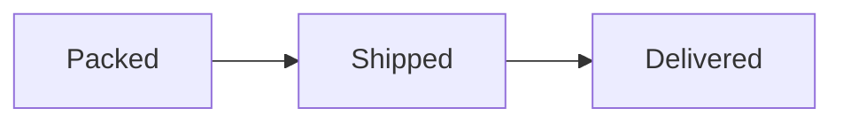

Send message bodies as text through the [Chatto API](/guides/integrations/chatto-api/).
Keep the source unchanged when you edit, quote, or copy messages. A client that
does not support a visual renderer can show the source code.

## Supported Markdown

Message bodies support paragraphs, ATX headings, bold, italic, underline,
links, inline and fenced code, blockquotes, lists, footnotes, and GFM pipe tables.
Use `**bold**`, `*italic*`, and `__underline__`. Double underscores mean underline,
including in existing messages. Code spans and code blocks keep their literal text.

Timestamp tokens such as `<t:UNIX_SECONDS:F>` identify a UTC instant. Clients
show valid tokens in the reader's locale and time zone. Clients without timestamp
support can show the token unchanged.

Emoji shortcodes such as `:wave:` and `:+1:` remain in the source and render as
Unicode emoji. Names are case-sensitive. Unknown names stay as text. Separate
shortcodes from letters, numbers, combining marks, and literal underscores.
Code blocks, inline code, and URLs do not expand shortcodes.

## Visual code blocks

Use `mermaid`, `svg`, or `ansi` as a code-fence language. Add `rendered` after
the language to request a visual presentation first. Rendering runs locally;
Chatto does not send the code to an external rendering service.

### Mermaid diagrams

````md

````

Mermaid diagrams use Pele. Links, external images, and source configuration are
disabled. Each message can render up to four diagrams with at most 10,000
characters each. Invalid, unsupported, or overly complex diagrams show source.
Add `accTitle` and `accDescr` for screen readers.

### SVG previews

````md
```svg rendered
<svg xmlns="http://www.w3.org/2000/svg" viewBox="0 0 120 60">
  <rect width="120" height="60" rx="12" fill="#257d68"/>
  <text x="60" y="36" text-anchor="middle" fill="white">Ready</text>
</svg>
```
````

SVG previews use isolated images. Include the SVG namespace. Scripts, links,
external resources, CSS, embedded images, filters, patterns, masks, clipping
paths, markers, and `use` references are removed. Simple `animate` and
`animateTransform` elements are supported; CSS animations, motion paths, and
event-based timing are not. Durations must be from `100ms` to `3600s`.

Each message can render up to four SVG previews, each with at most 100,000 source
characters, 1,000 elements, and 32 element levels including the root. DTD and
entity declarations are rejected. Unsupported or larger blocks show source.
The source message stays unchanged; image downloads contain the sanitized SVG.

### ANSI art

Use an `ansi rendered` fence. Send an actual Escape character (`U+001B`) in ANSI
sequences, rather than the literal text `\x1b`. For example, in JavaScript:

```js
const body = '```ansi rendered\n\x1b[91mHello in red!\x1b[0m\n```';
```

The renderer supports 16-color, 256-color, and true-color text on an 80-column
screen with up to 100 rows and no scrollback. It does not play animations or
execute terminal links or clipboard commands. The first four ANSI blocks render;
additional blocks show source. Use Unicode for box-drawing characters.

## Prevent a link preview

Put a complete HTTP or HTTPS URL in angle brackets:

```md
<https://example.com>
```

The URL stays clickable without a preview attachment. A later URL outside angle
brackets can still produce a preview. Omitting the closing angle bracket also
suppresses the preview.

## Links

Automatic links start with `www.`, `https://`, or `http://`. Bare domains,
filenames, and email addresses stay as text. Use an explicit Markdown link or
`mailto:` when needed. Message links permit HTTP, HTTPS, and `mailto:`. Explicit
Markdown links can also use a path that starts with one `/` on the current origin.
