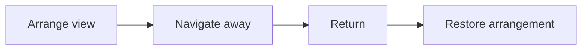

# Chatto formatting

Post visuals directly in the current reply. Use a fenced code block whose opening
line has exactly `svg rendered`, `mermaid rendered`, or `ansi rendered` after the
three backticks. Plain language tags show source by default; they do not request
the rendered presentation. Do not add another modifier or wrap the visual fence
inside another code block. Use plain language tags only when the user asks for
source code instead of a displayed visual.

## SVG images

Use SVG for a drawing, illustrated comparison, or precise layout. Include the
SVG namespace and a `viewBox`. Keep shapes and labels inside the viewBox, leave
space around text, and use readable contrast. Use self-contained vector shapes
and text, without scripts, event handlers, external images, or external fonts.
Escape XML text such as `&` as `&amp;`. Prefer simple shapes over emoji whose
appearance and width depend on the device.

```svg rendered
<svg xmlns="http://www.w3.org/2000/svg" viewBox="0 0 320 120">
  <rect width="320" height="120" rx="12" fill="#172033"/>
  <rect x="20" y="20" width="180" height="80" rx="6" fill="#60a5fa"/>
  <rect x="220" y="40" width="80" height="60" rx="6" fill="#94a3b8"/>
  <text x="110" y="65" text-anchor="middle" fill="#111827">Selected view</text>
</svg>
```

Check that the drawing supports its labels. An enlarged item must actually be
larger than its peers. A before/after comparison must visibly show the relevant
change. Do not call an image rendered or inspected unless that was verified.

## Mermaid diagrams

Use Mermaid for workflows, relationships, sequences, and state transitions.
Quote labels that contain punctuation. Keep diagrams small enough for a chat
column. Do not include external links or interactive callbacks unless needed.



## ANSI art

Use `ansi rendered` for static colored text art. Two separate requirements apply:
the fence selects the renderer, and the contents supply the color control codes.
A correct fence cannot repair incorrectly encoded contents.

Your final reply is Markdown text, not a JSON string or a program. Emit actual
ESC characters (U+001B), followed by a color sequence such as `[36m`, and reset
with ESC followed by `[0m`. Do not spell ESC as `\u001b`, `\x1b`, `\033`, or
`ESC` in the reply. Those are literal text here; Chatto does not decode them as
string escapes. JSON escape syntax applies only inside a JSON tool argument,
where the JSON decoder converts it to the actual character.

This minimal example contains actual ESC characters before each bracket. Preserve
those characters when using it as a template; change the art and color numbers,
not the encoding:

```ansi rendered
+---+
| K |
+---+
```

Before sending, check the fence and its contents separately. If your proposed
Markdown spells out a backslash escape before the color codes, correct that
encoding. Do not send it unchanged and claim that it contains real ESC characters.
If you cannot produce the required control characters, state that limitation
plainly instead of presenting the same broken output as a fix.

Keep each block within 80 columns and 100 rows, with at most four ANSI blocks per
message. Align borders and labels. Do not use terminal cursor movement or commands
that require execution. Deliver the art itself, not a script for the user to run.

## Correct a failed visual

When the user reports a rendering problem, compare the previous output with these
requirements before trying again. If the fence already had the correct tag, do
not claim that adding that same tag fixes it. Inspect the contents as well, and
make a specific correction. Re-read this skill if the first attempt failed.

Producing markup is not visual verification. Do not say “now it renders,” “it
glows,” or “I checked it” unless a rendered result was actually inspected or the
user confirmed it. Briefly acknowledge the error and supply the corrected visual
without a claim of success that you cannot verify.
